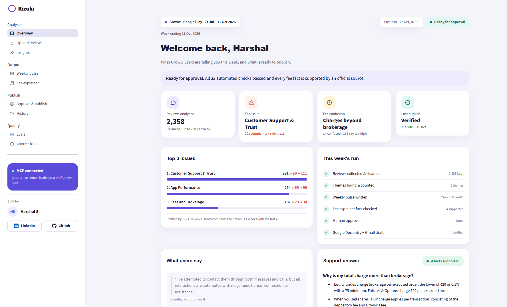
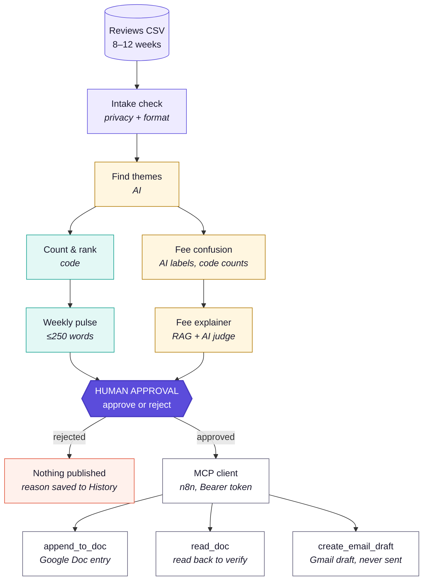
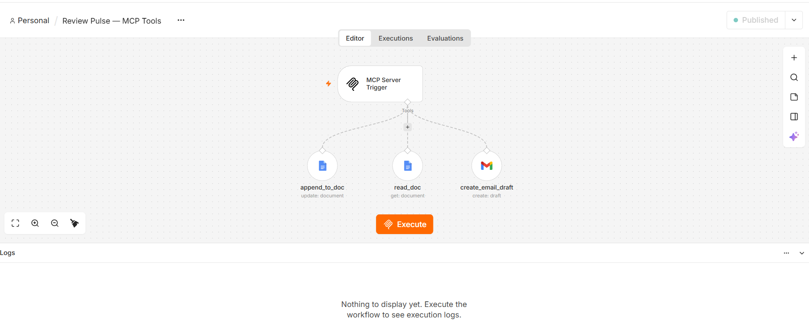
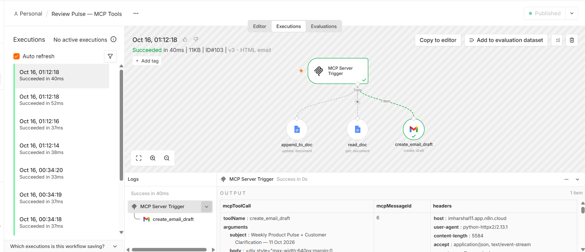

<div align="center">


### Turn app reviews into a weekly product pulse and a fact-checked support answer — published only after a human approves.

[](https://kizuki.streamlit.app)
[](outputs/eval_report.md)
[](#7-mcp-how-publishing-works)
[](requirements.txt)

**Kizuki** (気づき) is Japanese for *noticing* — the moment something becomes clear.



</div>

---

## Table of contents

| # | Section |
|---|---|
| 1 | [What this is](#1-what-this-is) |
| 2 | [The fee issue we found](#2-the-fee-issue-we-found-from-the-reviews) |
| 3 | [What I would do about it](#3-what-i-would-do-about-it) |
| 4 | [Results at a glance](#4-results-at-a-glance) |
| 5 | [How it works](#5-how-it-works) |
| 6 | [Where the approval happens](#6-where-the-approval-happens) |
| 7 | [MCP: how publishing works](#7-mcp-how-publishing-works) |
| 8 | [How to run it](#8-how-to-run-it) |
| 9 | [Deliverables](#9-deliverables) |
| 10 | [Design decisions](#10-design-decisions-and-why) |
| 11 | [Quality and evals](#11-quality-and-evals) |
| 12 | [Known limits and future work](#12-known-limits-and-future-work) |
| 13 | [Credits](#13-credits) |

---

## 1. What this is

Every week thousands of reviews arrive for an app. Two teams lose out:

- **Product managers** miss issues that are quietly growing.
- **Support leads** answer the same confusing fee question again and again, because nobody wrote one clear, correct answer.

Kizuki reads 12 weeks of Groww Play Store reviews and produces two things:

| Output | Who it's for | What it is |
|---|---|---|
| **Weekly product pulse** | Product team | A ≤250-word internal note: top 3 issues, real user quotes, one key observation, three action ideas |
| **Fee explainer** | Support team | A reusable, facts-only answer to the fee users are confused about, built only from official sources |

Nothing is published until a person reads it and approves. After approval, Kizuki logs the week to a **Google Doc** and saves a **Gmail draft** through **MCP**. It has no tool that can send email.

**Live app:** https://kizuki.streamlit.app

---

## 2. The fee issue we found (from the reviews)

> **Charges beyond brokerage are seen as hidden.** Users see the total cost of a trade and do not realise it includes charges other than brokerage — DP charges, statutory charges and GST.

This was not chosen by hand. It came out of the data:

| Signal | Count |
|---|---|
| Reviews mentioning a fee or charge | **215** |
| Users who **do not understand** a charge | **14** |
| Users who understand it but say it is **too high** | **175** |
| Users who say charges are **fine** | 13 |
| Not about Groww fees | 13 |
| Top confusion pattern: *other charges seen as hidden (taxes, DP, exchange)* | **7 of 14** |

A real review that captures it:

> "overall good but too many charges… 1 buy + sell order (fno) cause me 92. **brokerage 40 and external charges 50**"
> — 2★, Fees and Brokerage

The user can see brokerage. The other ₹50 is the part nobody explained.

**Why this matters:** complaining is not the same as being confused. A support explainer can fix confusion; it cannot fix a price. Kizuki separates the two so the right team gets the right signal.

---

## 3. What I would do about it

Three issues are rising. A product team cannot fix all three at once, so here is how I would sequence them and how I would know it worked.

| Priority | Issue | Why this order | Proposed fix | How we would know it worked |
|---|---|---|---|---|
| **1** | **App performance** | Rising fastest (**+46%**), tied to a specific recent release, and usually the cheapest to fix. A broken chart during market hours costs a trade, not just goodwill | Investigate chart-render regression in the latest build; ship a fix and monitor | 1–2★ performance reviews fall back under 65 in 4 weeks; crash-free sessions recover to the pre-release level |
| **2** | **Fee clarity** | The cheapest real win. **14 users** do not understand charges and **175** think they are too high — some of that second group may simply not see what they are paying for | Show a full charge breakdown before order confirmation, and publish the support snippet Kizuki generated | Fee-confusion reviews drop below 14 per 12 weeks; support tickets tagged "charges" fall; "hidden" stops appearing in fee reviews |
| **3** | **Support reachability** | Highest volume (**291**) and rising, but the most expensive to fix — it needs headcount or a routing change, not a code change | Add a "talk to a person" escape hatch when an automated reply fails to resolve | 1–2★ support reviews fall below 90 in 8 weeks; first-human-response time is tracked and reported |

**An honest gap:** these reviews tell us the **signal**, not the **cost**. To prioritise properly I would want churn and uninstall data, support ticket volume by tag, and the app-rating trend alongside this. Kizuki measures what users say; it does not yet measure what it costs the business. That link is the next thing I would build.

---

## 4. Results at a glance

### From raw reviews to insights

| Stage | Count | Note |
|---|---|---|
| Collected from the Play Store | 12,800 | newest first, until 12 weeks old |
| After cleaning | 3,229 | blank, very short and duplicate reviews removed |
| **Analysed** | **2,358** | balanced sample, up to 200 per week, 12 weeks |
| Mentioning a fee | 215 | 14 confused · 175 say too high |

Period: **21 Jul – 11 Oct 2026** (12 weeks)

### Themes found

| Rank | Theme | Reviews | Share | Avg ★ | 1–2★ | Problem rate |
|---|---|---|---|---|---|---|
| **1** | **Customer Support & Trust** | 364 | 15.4% | 1.74 | **291** | 79.9% |
| **2** | **App Performance** | 373 | 15.8% | 2.13 | **254** | 68.1% |
| **3** | **Fees and Brokerage** | 193 | 8.2% | 2.55 | **107** | 55.4% |
| 4 | Feature Gaps | 317 | 13.4% | 3.25 | 107 | 33.8% |
| 5 | User Interface & Experience | 1,111 | 47.1% | 4.62 | 74 | 6.7% |

**Ranking rule:** top 3 by number of 1–2★ reviews (problem volume); ties broken by higher problem rate.
Fees and Feature Gaps both had 107 one- and two-star reviews. Fees ranks higher because **55.4%** of its reviewers were unhappy, versus **33.8%** for Feature Gaps.

### Trend (1–2★ reviews, previous 4 weeks → last 4 weeks)

| Theme | Previous | Last | Change |
|---|---|---|---|
| Customer support | 90 | 111 | **+23%** |
| App performance | 65 | 95 | **+46%** |
| Fees and brokerage | 29 | 34 | **+17%** |

All three problem areas are rising. App performance is rising fastest.

---

## 5. How it works



<sub>🟪 Data &nbsp;·&nbsp; 🟨 AI writes or labels &nbsp;·&nbsp; 🟩 Code counts and enforces limits &nbsp;·&nbsp; 🟦 Human gate &nbsp;·&nbsp; ⬜ MCP tools</sub>

### The six stages

| Stage | What happens | Who does it |
|---|---|---|
| **1. Collect & clean** | Fetch reviews, drop blanks, duplicates and one-word reviews, remove names, mask emails and phone numbers, keep a balanced sample per week | Code |
| **2. Find themes** | Group reviews into at most 5 themes, then label every review | AI |
| **3. Count & rank** | Count reviews per theme, 1–2★ volume, problem rate, weekly trend, pick top 3 | **Code** |
| **4. Write the pulse** | Write theme insights, key observation and 3 action ideas; enforce ≤250 words | AI writes words, code inserts numbers |
| **5. Explain the fee** | Retrieve passages from official pages, write ≤6 bullets, then check each bullet against its source | AI + **AI judge** |
| **6. Approve & publish** | Show everything, take an approval or rejection, then call the MCP tools | **Human**, then code |

### Models used

| Role | Model | Used for |
|---|---|---|
| Reasoning model | `openai/gpt-oss-120b` (Groq) | Theme discovery, quote selection, pulse writing, fee explainer writer and judge |
| Fast model | `openai/gpt-oss-20b` (Groq) | Labelling 2,358 reviews into themes, labelling 215 fee reviews |

---

## 6. Where the approval happens

**Page:** `Approve & publish` → file [`pages/approve.py`](pages/approve.py)
**Command line equivalent:** `python src/publish.py` → file [`src/publish.py`](src/publish.py)

Nothing reaches Google Docs or Gmail until a person acts. The gate works like this:

| Step | What it does |
|---|---|
| 1. Preview | Shows the exact Gmail draft and the exact Google Doc entry that will be written |
| 2. Fingerprint | Takes a **SHA-256 hash** of the approved content |
| 3. Confirm | The user must type **`APPROVE`** in capitals. A Reject button sits beside it |
| 4. Duplicate check | Reads the Doc first — if this week already exists, it stops |
| 5. Fingerprint re-check | Recomputes the hash before every tool call. If the content changed after approval, publishing is **blocked** |
| 6. Write | `append_to_doc` adds the entry |
| 7. Read back | `read_doc` confirms the approval ID is really in the Doc |
| 8. Draft | `create_email_draft` saves a Gmail draft. **No tool exists that can send email** |

**Rejecting** requires a reason (fee issue wrong, quote misleading, numbers wrong, wording not ready, other) plus an optional note. The rejection is saved to the audit trail with its own ID, and **nothing is written anywhere**.

**If something fails halfway**, the approval is saved and can be resumed from the History page. The duplicate check guarantees no double entry.

**On the public link**, Approve and Reject are protected by an owner password (`APP_PASSWORD`), so anyone can read the app but only the owner can publish.

---

## 7. MCP: how publishing works

MCP (Model Context Protocol) is a standard way for an app to use external tools — think of it as USB-C for software tools.

**This project implements MCP as an n8n MCP Server with three tools, called by a Python MCP client, behind a human approval gate.**

<div align="center">

<br><em>The n8n MCP Server Trigger exposing three tools — append_to_doc, read_doc and create_email_draft</em>
<br><br>

<br><em>A real call recorded in n8n: the Python client invoked <code>create_email_draft</code> with the approved subject and body, and it succeeded in 40&nbsp;ms</em>
</div>

### The three tools

| Tool | Operation | Inputs | Safety design |
|---|---|---|---|
| `append_to_doc` | Google Docs → Update | `entry` | Document ID is **fixed in n8n**, not chosen by the app |
| `read_doc` | Google Docs → Get | none | **Read-only.** Used for the duplicate check and read-back |
| `create_email_draft` | Gmail → **Draft → Create** | `subject`, `body` | Recipient fixed. **There is no send tool** |

### Why it is safe by design

- **No send tool exists.** "No auto-send" is guaranteed by what was built, not by trusting a prompt.
- **The document is fixed.** The app cannot be tricked into writing somewhere else.
- **Reviews are data, never instructions.** User-written review text never controls which tool runs.
- **The MCP endpoint is protected** by a Bearer token held in environment secrets.
- **Code calls the tools, not an AI agent.** After approval, the exact approved text is sent — nothing is re-generated.

### Verifying the connection

```bash
python src/mcp_check.py
```

```
Tools exposed by the server (3):
  - read_doc            parameters: (none)
  - create_email_draft  parameters: subject, body
  - append_to_doc       parameters: entry
MCP CHECK PASSED
```

> **Note on the n8n instance:** the MCP server runs on an n8n Cloud trial that expires shortly after submission. The workflow export is included in `deliverables/` so it can be re-imported, and the demo video plus screenshots show it working live.

---

## 8. How to run it

### What you need

- Python 3.12
- A free [Groq](https://console.groq.com) API key
- *(Optional, for publishing)* an n8n instance with the three tools above, plus Google Docs and Gmail connected

### Setup

```bash
git clone https://github.com/imharshal11/review-pulse.git
cd review-pulse

python -m venv venv
venv\Scripts\activate          # Windows
# source venv/bin/activate     # macOS / Linux

pip install -r requirements.txt
```

Create a `.env` file in the project root:

```env
GROQ_API_KEY=gsk_your_key_here
GROQ_MODEL=openai/gpt-oss-120b
GROQ_MODEL_FAST=openai/gpt-oss-20b

# Only needed to publish
N8N_MCP_URL=https://your-instance.app.n8n.cloud/mcp/your-path
N8N_MCP_TOKEN=your-bearer-token
APP_PASSWORD=choose-a-password
```

### Run the app

```bash
streamlit run app.py
```

Opens at `http://localhost:8501`.

### Run the pipeline from the command line

```bash
python src/run_all.py --skip-publish        # analyse only, nothing is published
python src/run_all.py                       # includes publishing; you must type APPROVE
python src/run_all.py --input data/your_reviews.csv --skip-publish
```

### Individual steps

| Command | What it does |
|---|---|
| `python src/fetch_reviews.py` | Fetch reviews from the Play Store into `data/reviews.csv` |
| `python src/validate_csv.py data/reviews.csv` | Check a CSV before analysis |
| `python src/analyze_reviews.py` | Themes, quotes, fee confusion |
| `python src/generate_pulse.py` | Weekly pulse (≤250 words) |
| `python src/build_knowledge.py` | Download the official source pages |
| `python src/fee_explainer.py` | Fee explainer with fact-check |
| `python src/mcp_check.py` | Verify the MCP connection |
| `python src/publish.py` | Approval gate and publishing |
| `python src/evals.py` | Run all 32 automated checks |

### Using your own reviews

Upload a CSV on the **Upload reviews** page, or use `--input`. Required columns: `text`, `date`, `rating`. A template is downloadable in the app.

Kizuki works with any app's review data for themes, quotes and the weekly pulse. **The fee explainer is Groww-specific**, because its facts come from Groww's own pricing pages.

---

## 9. Deliverables

| Deliverable | Where |
|---|---|
| **Working prototype** | **https://kizuki.streamlit.app** |
| Demo video (≤3 min) | [`deliverables/demo.mp4`](deliverables/) |
| Weekly product pulse | [`outputs/weekly_pulse.md`](outputs/weekly_pulse.md) |
| Fee explainer | [`outputs/fee_explainer.md`](outputs/fee_explainer.md) |
| Google Doc entry (appended) | [Review Pulse — Weekly Log](https://docs.google.com/document/d/1YEpRWWPLN52DmpdBNt5To9o_uSjXRoVsvMhA3EZD2BY/edit?usp=sharing) · screenshot in [`deliverables/screenshots/`](deliverables/screenshots/) |
| Email draft | [`deliverables/screenshots/gmail_draft.png`](deliverables/screenshots/) |
| Reviews CSV sample (real) | [`data/reviews.csv`](data/reviews.csv) — 2,358 reviews, 12 weeks |
| Reviews CSV sample (synthetic) | [`data/groww_synthetic_reviews.csv`](data/groww_synthetic_reviews.csv) — 1,500 generated reviews for testing |
| Source list | [`knowledge/sources.md`](knowledge/sources.md) |
| Eval report | [`outputs/eval_report.md`](outputs/eval_report.md) — 32/32 |
| n8n workflow export | [`deliverables/n8n_workflow.json`](deliverables/) |

### The weekly pulse (247 / 250 words)

> **Groww Weekly Product Pulse — Week ending 11 Oct 2026**
> Based on 2,358 Play Store reviews, 2026-07-21 to 2026-10-11.
>
> **Top themes** *(1–2★ reviews, previous 4 weeks → last 4 weeks)*
> 1. **Customer Support & Trust** — 291 complaints (↑ 90 → 111)
> 2. **App Performance** — 254 complaints (↑ 65 → 95)
> 3. **Fees and Brokerage** — 107 complaints (↑ 29 → 34)
>
> **Action ideas**
> 1. Provide live human agents for inquiries that currently receive only automated replies.
> 2. Optimize chart rendering to eliminate long loading delays reported after the recent update.
> 3. Clarify each charge trigger in the UI, explaining why fees are applied beyond brokerage.

Full note: [`outputs/weekly_pulse.md`](outputs/weekly_pulse.md)

### The fee explainer

**Why the total charge on a trade can be more than brokerage**

- Equity trades charge brokerage per executed order, the lower of ₹20 or 0.1% with a ₹5 minimum. Futures & Options charge ₹20 per executed order. `S1` `S2`
- When you sell shares, a DP charge applies per transaction, consisting of the depository fee and Groww's fee. `S1` `S3`
- STT, stamp duty, exchange transaction charges, SEBI turnover charge and IPFT are regulatory/statutory charges levied by the exchange, not by Groww. `S3`
- An 18% GST is added on brokerage, DP charges, exchange transaction charges, IPFT and SEBI turnover charges. `S1`
- *(Summary)* The overall trade cost includes brokerage plus DP, regulatory, statutory and GST charges, so it may exceed brokerage alone.

**Last checked:** 14 Oct 2026 · **Fact-check:** 4 of 4 fact bullets supported, 0 unsupported, 0 unverified

### Sources

| ID | Source | Link |
|---|---|---|
| S1 | Groww — Stocks pricing | https://groww.in/pricing/stocks |
| S2 | Groww — Futures & Options pricing | https://915.groww.in/pricing |
| S3 | Groww Help — How much does Groww charge for stocks? | https://groww.in/help/stocks%2C-f%26o%2C-ipo-%26-mtf/sx-demat-account/how-much-does-groww-charge-for-stocks-1 |
| S4 | NSE circular — Revision in Transaction Charges | https://nsearchives.nseindia.com/content/circulars/FA73061.pdf |

---

## 10. Design decisions (and why)

| Decision | Why |
|---|---|
| **AI judges, code counts** | Language models are unreliable with arithmetic. Every number in every output is computed by Python from the labelled data, so it can be recomputed and checked. |
| **Quotes are copied, never written** | The AI returns only a review **ID**. Python copies the exact text from the CSV. A quote can never be invented or "improved". |
| **A balanced sample, up to 200 per week** | A busy week would otherwise drown out a quiet one and distort the trend. |
| **Rank by problem volume, not total volume** | The largest theme was positive UI feedback (47% of reviews, 4.62★). Leading a product note with "people like the UI" is not actionable. |
| **A written tie-break rule** | Two themes tied at 107. The rule (higher problem rate wins) was written before looking at which theme it favoured. |
| **Confused vs complaining** | 175 users think charges are too high; only 14 do not understand them. A support explainer fixes the second group, not the first. |
| **A second AI pass as fact-checker** | A number check is not a truth check. The judge caught a bullet that merged the equity and F&O brokerage rules into one wrong sentence. |
| **No send tool in MCP** | "No auto-send" is guaranteed by what was built, not by trusting an instruction. |
| **Approval bound to a content hash** | Approving content is meaningless if the content can change afterwards. |
| **Read-back after writing** | Assuming a write succeeded is not the same as proving it did. |
| **No AI agent decides tool calls** | After a human approves specific text, that exact text should be published — not something regenerated. |

### Two things that went wrong, and what they taught

**1. The AI said 182 users were confused. Code counting said 14.**
An early version asked the AI to count confused reviews. It returned 182 of 215. When each review was labelled individually and Python counted the labels, the real figure was 14 confused and 175 simply complaining about price. Two very different product problems.

**2. Flattened web tables lose meaning.**
When official pricing pages were scraped, the table structure disappeared, leaving numbers without their column headers. The AI then attached a rate to the wrong segment. The fix was to forbid segment-specific statutory rates in the explainer and cite the source's own wording instead.

---

## 11. Quality and evals

```bash
python src/evals.py
```

**32 of 32 checks pass.** No AI calls, runs in seconds, exit code 0 or 1.

| Group | Checks | Examples |
|---|---|---|
| Data | 4 | Required columns present, no name or email columns, 8–12 week span |
| Insights | 4 | At most 5 themes, problem counts recomputed from the labelled CSV, all 3 quotes found word-for-word in the source |
| Weekly pulse | 5 | ≤250 words, all four sections present, exactly 3 action ideas, every quote an exact substring |
| Fee explainer | 6 | ≤6 bullets, exactly 2 official links, every number traced to its cited source, judge reports 0 unsupported |
| Approval & MCP | 6 | Approval record complete, hash recomputes correctly, read-back verified, **no tool with "send" in its name** |
| Edge cases | 7 | Empty file, missing column, too few rows, bad ratings, PII masked, private column dropped, 20 weeks trimmed to 12 |

Full report: [`outputs/eval_report.md`](outputs/eval_report.md)

### Robustness

| Situation | What happens |
|---|---|
| Rate limit from the model provider | Retries with increasing waits; cached results are reused |
| Connection to n8n fails | Friendly message, nothing published, approval saved for resume |
| This week already logged | Publishing stops with a clear message |
| A fee fact cannot be confirmed | The explainer is held as a draft marked "needs human review" |
| Bad CSV uploaded | Rejected with specific, fixable errors; existing results untouched |
| Personal data in a review | Emails and phone numbers masked, name columns dropped |

---

## 12. Known limits and future work

**Current limits**

- English Play Store reviews only.
- The fee explainer's sources are Groww-specific. Other apps get themes, quotes and the pulse but not the explainer.
- The fact-check judge uses the same model family as the writer. A different model would be a stronger check.
- Google Doc entries are plain text; the Docs connector cannot apply formatting.
- The n8n instance is a trial that expires shortly after submission.

**Next steps, in priority order**

1. **An independent judge model** from a different provider, to remove self-grading.
2. **Embedding-based clustering** as a second opinion on themes, cross-checked against the AI's grouping.
3. **A scheduled weekly run** that prepares everything and waits for approval. The schedule never approves; a person still does.
4. **Per-product source packs**, so the fee explainer works for any app by swapping its official sources.
5. **A self-hosted MCP server**, removing the dependency on a hosted n8n trial.

---

## 13. Credits

**Built by Harshal S** — NextLeap PM Fellowship, Milestone 5: *RAGs & Context Engineering*.

[LinkedIn](https://www.linkedin.com/in/imharshal11) · [GitHub](https://github.com/imharshal11)

This project builds on Milestone 4, [Tathya](https://github.com/imharshal11/tathya-mf-faq-bot) — a facts-only mutual fund FAQ assistant. Tathya answers questions with verified facts; Kizuki listens to what users are struggling with and produces the answer before they ask.

**Disclaimer:** an independent learning project, not affiliated with or endorsed by Groww. All review data is public. Fee information is quoted from official public pages and was last checked on the date shown in the explainer; always check the source for current charges.
